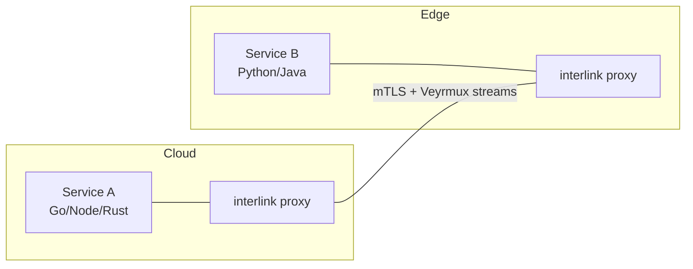
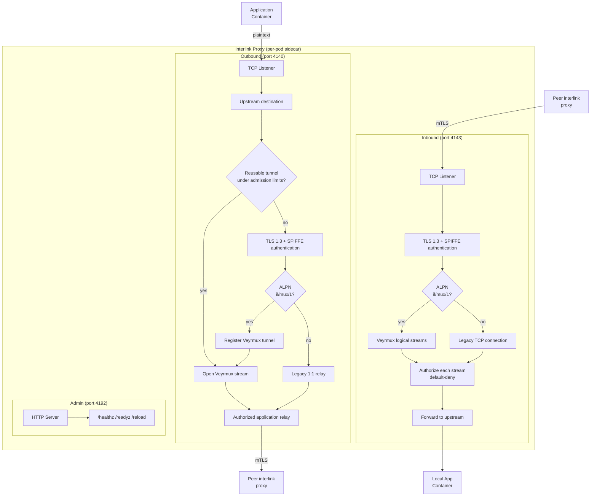

# interlink

**A lightweight service mesh proxy written in Rust.** SPIFFE mTLS, default-deny authorization, protocol detection, and native Tokio multiplexing with [Veyrmux](https://github.com/alexandernicholson/veyrmux). Many application connections share an authenticated proxy-to-proxy tunnel.



<hr />

## Quick Start

Requires Rust 1.89 or later.

### Example programs

```bash
# Generate certificates
cargo run --example ca_bootstrap

# Terminal 1: start backend
cargo run --example backend -- /tmp/interlink-demo 8443

# Terminal 2: connect frontend
cargo run --example frontend -- /tmp/interlink-demo localhost:8443
```

Expected output:

```
mTLS connected! Backend identity = spiffe://example.local/ns/default/sa/backend
Sent: Hello from frontend!
Received: backend-echo[frontend]: Hello from frontend!
```

### Run the `interlinkd` daemon

```bash
# Run with defaults (reads env vars and an optional config file)
cargo run --bin interlinkd

# Override specific settings
INTERLINK_INBOUND_PORT=4143 \
INTERLINK_OUTBOUND_PORT=4140 \
INTERLINK_ADMIN_PORT=4192 \
INTERLINK_CA_CERT=/etc/interlink/ca.der \
INTERLINK_CA_KEY=/etc/interlink/ca.key \
cargo run --bin interlinkd
```

See [Configuration](#configuration) and the full [Quickstart Guide](docs/examples/quickstart.md) for the full set of options.

<hr />

## Configuration

For a step-by-step walkthrough, see the [Quickstart Guide](docs/examples/quickstart.md).

`interlinkd` loads configuration from two sources, in order of increasing precedence:

1. A JSON config file (default: `/etc/interlink/config.json`)
2. Environment variables prefixed with `INTERLINK_`

Example config file:

```json
{
  "inbound_port": 4143,
  "outbound_port": 4140,
  "admin_port": 4192,
  "ca_cert_path": "/etc/interlink/ca.der",
  "ca_key_path": "/etc/interlink/ca.key",
  "node_name": "worker-01",
  "cluster_domain": "cluster.local",
  "metrics_enabled": true
}
```

Environment variable equivalents:

| Variable | Description | Default |
|----------|-------------|---------|
| `INTERLINK_PROXY_INBOUND_PORT` | Inbound transparent proxy port | 4143 |
| `INTERLINK_PROXY_OUTBOUND_PORT` | Outbound transparent proxy port (0 disables) | 4140 |
| `INTERLINK_METRICS_PORT` | Prometheus metrics port | 4190 |
| `INTERLINK_TRUST_DOMAIN` | SPIFFE trust domain | `cluster.local` |
| `INTERLINK_IDENTITY` | This proxy's SPIFFE ID | derived |
| `INTERLINK_CA_BUNDLE_PATH` | CA bundle (DER or PEM) for peer validation | — |
| `INTERLINK_CERT_PATH` / `INTERLINK_KEY_PATH` | Leaf cert (DER or PEM) / key (PKCS#8 DER or PEM) | — |
| `INTERLINK_DEFAULT_UPSTREAM` | Fallback upstream when `SO_ORIGINAL_DST` is unavailable | — |
| `INTERLINK_MUX` | Offer multiplexed tunnels (ALPN `il/mux/1`) to peers | `true` |
| `INTERLINK_ACCEPTORS` | SO_REUSEPORT acceptor tasks per listener (1–16) | `max(2, min(available CPUs, 4))` |
| `INTERLINK_COPY_BUF_SIZE` | Relay copy buffer size in bytes (4 KiB–1 MiB) | `65536` |
| `INTERLINK_MAX_CONNECTIONS` | Per-proxy connection limit | 1024 |
| `INTERLINK_CONFIG_FILE` | Path to JSON config file | `/etc/interlink/config.json` |

`POST /reload` on the admin port atomically reloads the CA bundle, leaf certificate, and private key for new handshakes. A reload succeeds only when the files form a trusted, currently valid key pair with the configured SPIFFE identity; otherwise it returns `500` and preserves the last-known-good credentials. Existing TLS streams are uninterrupted.

For a Signet agent using its default shared-volume layout, point Interlink at the same files and set `INTERLINK_IDENTITY` to the SPIFFE ID derived from the agent's trust-domain, namespace, and service-account arguments:

```sh
INTERLINK_CA_BUNDLE_PATH=/var/run/interlink/ca-bundle.pem
INTERLINK_CERT_PATH=/var/run/interlink/identity/tls.crt
INTERLINK_KEY_PATH=/var/run/interlink/identity/tls.key
```

<hr />

## Architecture

For deployment topologies and detailed connection flows, see the [Architecture Overview](docs/architecture/overview.md) and [Key Management](docs/architecture/key-management.md) docs.



Veyrmux uses Tokio I/O directly and remains wire-compatible with Yamux v0 under
the unchanged `il/mux/1` ALPN. Rolling-version tests cover stock Yamux peers in
both directions. Stock Yamux and the Tokio/Futures compatibility adapter are
test-only dependencies.

`INTERLINK_MUX=false` disables the multiplexing offer; peers without mux use
one-to-one relays. A negotiated protocol is always honored.

<hr />


## RFC References

Detailed RFC compliance notes live in [`docs/rfcs/`](docs/rfcs/).

| RFC | Title | Usage |
|-----|-------|-------|
| [RFC 8446](docs/rfcs/rfc-8446-tls1.3.md) | TLS 1.3 | mTLS handshake, cipher suites, key exchange |
| [RFC 5280](docs/rfcs/rfc-5280-x509.md) | X.509 PKI | Certificate profiles, SAN encoding, path validation |
| [RFC 9110](docs/rfcs/rfc-911x-http.md) | HTTP Semantics | Method tokens, status codes, header handling |
| [RFC 9112](docs/rfcs/rfc-911x-http.md) | HTTP/1.1 | Request-line format, persistent connections |
| [RFC 9113](docs/rfcs/rfc-911x-http.md) | HTTP/2 | Frame format, multiplexing, connection preface |
| [RFC 1034](lore/rfc-103x-dns.md) | DNS Concepts | Hierarchical namespace, resolution algorithm |
| [RFC 1035](lore/rfc-103x-dns.md) | DNS Implementation | Message format, resource records |
| [RFC 9293](https://www.rfc-editor.org/rfc/rfc9293.html) | TCP | Connection management, congestion control |

<hr />

## Project Structure

```
interlink/
├── Cargo.toml              # Dependencies (tokio, rustls, veyrmux, rcgen, hickory-resolver, metrics)
├── README.md               # This file
├── lore/                   # Architecture decisions & RFC plans
│   ├── ideation.md         # Component breakdown, resource budget
│   ├── architecture-decisions.md  # ADR-0001 through ADR-0008
│   ├── rfc-8446-tls1.3.md  # TLS 1.3 implementation plan
│   ├── rfc-5280-x509.md    # X.509 PKI implementation plan
│   ├── rfc-911x-http.md    # HTTP/1.1 + HTTP/2 plan
│   └── rfc-103x-dns.md     # DNS implementation plan
├── docs/                   # Documentation
│   ├── architecture/       # Deployment topologies, network flows
│   ├── rfcs/               # RFC summaries and compliance
│   ├── examples/           # Example walkthroughs
│   └── benchmarks/         # Performance data
├── src/
│   ├── lib.rs              # Module root
│   ├── common/             # Identity types, errors, constants
│   │   ├── identity.rs     # SpiffeId, TrustDomain, IdentityProvider
│   │   ├── error.rs        # InterlinkError enum
│   │   ├── constants.rs    # Ports, timeouts, buffer sizes
│   │   └── config.rs       # Runtime configuration
│   ├── identity/
│   │   ├── ca/mod.rs       # CertificateAuthority (Ed25519, rcgen)
│   │   └── provider/       # K8s/environment identity providers
│   ├── proxy/
│   │   ├── handshake.rs    # TlsHandshake trait, TlsClient, TlsServer
│   │   ├── tcp.rs          # Inbound TcpProxy (accept, mTLS, forward, copy)
│   │   ├── outbound.rs     # Outbound proxy: mux tunnel pool + 1:1 fallback
│   │   ├── mux.rs          # Native Tokio Veyrmux tunnels, Yamux-v0 wire format, per-peer pool
│   │   ├── verify.rs       # SpiffeServerVerifier: RFC 5280 chain + SPIFFE identity (no RFC 6125 name match)
│   │   ├── original_dst.rs # SO_ORIGINAL_DST helper (optional transparent mode, self-connect guarded)
│   │   └── config.rs       # ProxyConfig
│   ├── admin/mod.rs        # Admin HTTP server (/healthz, /readyz, /reload)
│   ├── protocol/mod.rs     # ProtocolDetector (H1, H2, TCP)
│   ├── discovery/dns.rs    # ServiceDiscovery (hickory-resolver)
│   ├── policy/mod.rs       # PolicyEngine (default-deny, wildcards)
│   └── metrics/mod.rs      # Prometheus exporter, atomic counters
├── examples/
│   ├── ca_bootstrap.rs     # Generate CA + certs
│   ├── backend.rs          # mTLS echo server
│   └── frontend.rs         # mTLS client
├── scripts/
│   └── demo.sh             # End-to-end demo runner
├── tests/
│   ├── e2e_proxy_test.rs        # Full mTLS handshake + echo through proxy
│   ├── mtls_handshake.rs        # SPIFFE, policy, TLS-resumption tests
│   ├── mux_tunnel.rs            # Mux tunnels: 1 handshake for N conns, pool past 512 streams, fallback
│   ├── spiffe_verify.rs         # SPIFFE server verification: identity accept, untrusted-CA/wrong-domain reject
│   ├── halfclose_propagation.rs # FIN/close_notify propagation through the relay
│   └── proxy_shutdown.rs        # Accept-loop shutdown + bind-failure handling
├── test-support/           # Shared mTLS integration-test fixtures
└── benches/
    ├── proxy.rs            # Protocol, identity, policy and relay decisions
    ├── runtime.rs          # DNS, config, metrics and runtime services
    ├── crypto.rs           # TLS/certificate and cryptographic operations
    ├── data_plane.rs       # Real two-proxy mux/legacy connection lifecycles
    └── path_inventory.json # Declared semantic cases and locked source-coverage limits
```

<hr />

## Test Suite

```bash
./scripts/preflight.sh        # strict clippy, tests, 186 semantic benchmark paths + coverage gate
cargo test                    # Unit and integration suites
cargo bench                   # Criterion benchmarks
bash scripts/demo.sh          # End-to-end mTLS demo
```

| Suite | What it covers |
|-------|----------------|
| Unit | Validated identity, compiled policy, CA, gated DNS single-flight, mux coordination, relay progress, metrics and config |
| Integration | Real mTLS, resumption, concurrent mux streams, native/stock-Yamux rolling interoperability, exact bytes and EOF, rejection/reset isolation, half-close, credential reload and shutdown |

<hr />

## Benchmarks

### Native Veyrmux integration — 2026-11-17

Matched Linux measurements compare the previous stock-Yamux runtime with native
Veyrmux. Lower lifecycle latency is better.

| Path / payload each way | Stock Yamux, µs | Native Veyrmux, µs | Change |
| --- | ---: | ---: | ---: |
| Mux / 35 B | 253.7 | 239.0 | −5.8% |
| Mux / 16 KiB | 268.7 | 239.0 | −11.1% |
| Legacy control / 35 B | 487.6 | 490.8 | +0.7% |
| Legacy control / 16 KiB | 506.6 | 509.0 | +0.5% |

Eight fixed ABBAABBA blocks, four block medians per arm, on Linux/x86-64 with
eight vCPUs, Rust 1.100, full LTO, one codegen unit and mimalloc. Both runtimes
use the same harness; each block runs in a fresh loopback-only network namespace.
The benchmark process contains two actual proxies and a TCP echo service.

Every timed request includes application TCP connect, payload write, half-close,
exact echo and peer EOF. Fixtures are untimed. These are sequential completed-
connection latencies—not maximum throughput, request p99, cross-host latency or
production NAT overhead.

[Methodology and historical results](docs/benchmarks/results.md) ·
[Raw samples, per-block intervals and source/binary hashes](bench/results/veyrmux-integration/comparison.json)

### Run benchmarks

```bash
cargo bench --bench data_plane -- 'proxy_relay/(mux|legacy)_(small|16kb)$'
cargo bench --bench proxy
cargo bench --bench runtime
cargo bench --bench crypto
```

These commands measure the current checkout; they do not reconstruct the matched
historical A/B automatically. See the [benchmark guide](bench/README.md) for
workload selection and reproduction requirements.

### Other workloads and historical captures

| Results | Captured | Scope |
| --- | --- | --- |
| [Single inbound-proxy Fortio profiles](bench/local/results/proxy-summary.md) | 2026-11-16 | Pre-cutover HTTP/churn/bulk profiles; not a native-mux A/B |
| [Service-mesh comparison](bench/results/comparison.md) | 2026-07-08 | HTTP workload across kind workers; interlink/Linkerd sidecars versus Istio ambient |
| [Primitive microbenchmarks](docs/benchmarks/results.md) | 2026-07-08 | Individual operations, not service latency or capacity |

The earlier −63% proxy-CPU churn result compares multiplexing with per-connection
handshakes, not Veyrmux with Yamux; see the [performance roadmap](docs/performance-plan.md).
Do not combine that CPU result with the lifecycle-latency reductions above.

<hr />

## License

Licensed under the [MIT License](LICENSE).

<hr />

## References

- [SPIFFE](https://spiffe.io) — Secure Production Identity Framework for Everyone
- [IETF RFC Editor](https://www.rfc-editor.org) — All referenced RFCs
- [Linkerd](https://linkerd.io) — Inspiration for the sidecar proxy pattern
- [rustls](https://github.com/rustls/rustls) — TLS library in Rust
- [rcgen](https://github.com/rustls/rcgen) — X.509 certificate generation
