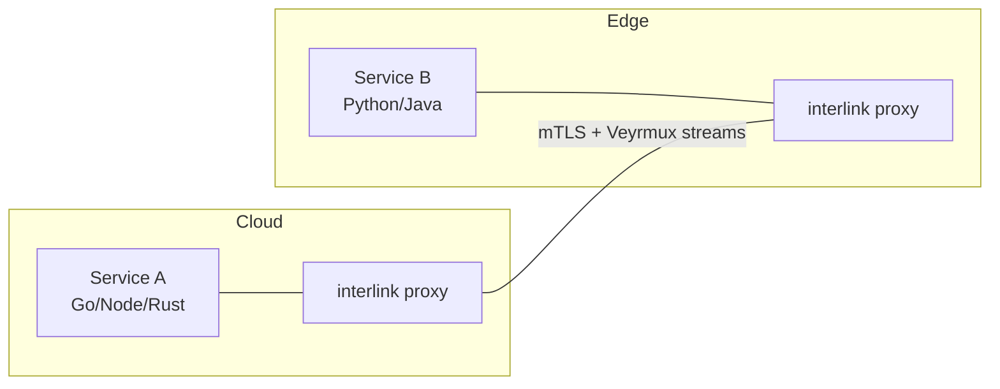
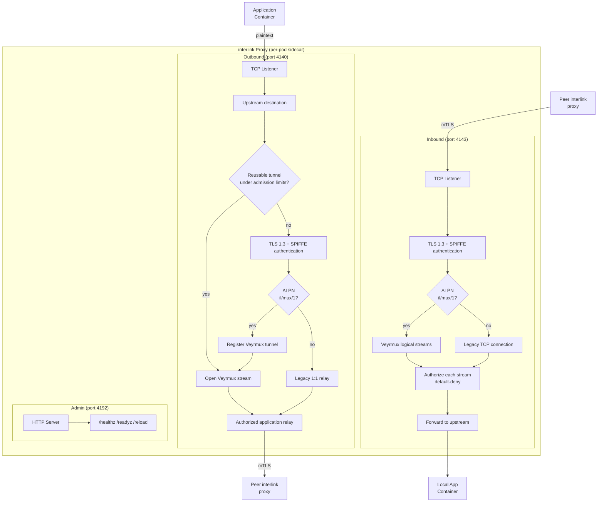
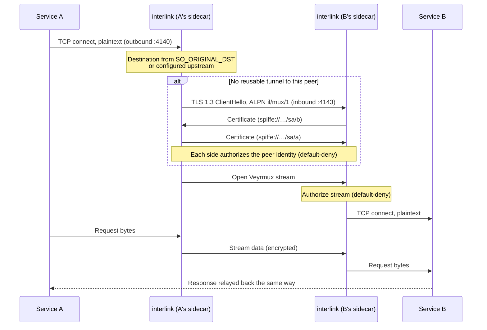

# interlink

A lightweight service mesh proxy written in Rust: SPIFFE mTLS, default-deny authorization, and protocol detection.
[Veyrmux](https://github.com/alexandernicholson/veyrmux) lets application connections share authenticated proxy-to-proxy tunnels.



## Quick Start

Requires Rust 1.89 or later and a Unix-like system.
Run these commands from your [checkout](https://github.com/alexandernicholson/interlink):

```bash
# Generate local demo credentials; /tmp/interlink-demo must not exist.
TMPDIR=/tmp cargo run --example ca_bootstrap

# Terminal 1: start the mTLS echo backend.
cargo run --example backend -- /tmp/interlink-demo 8443

# Terminal 2: send a message over mTLS.
cargo run --example frontend -- /tmp/interlink-demo 127.0.0.1:8443
```

The frontend logs the backend identity and response:

```text
mTLS connected! Backend identity = spiffe://example.local/ns/default/sa/backend
Received: backend-echo[frontend]: Hello from frontend!
```

These examples use the TLS library directly. To run the proxy, follow the
[quickstart guide](docs/examples/quickstart.md).

### Run `interlinkd`

Provide an issued leaf certificate, its private key, and a trusted CA bundle.
Set `INTERLINK_IDENTITY` to the SPIFFE URI in the certificate.
Replace the identity and paths below with your issued credentials:

```bash
INTERLINK_TRUST_DOMAIN=example.local \
INTERLINK_IDENTITY=spiffe://example.local/ns/default/sa/proxy \
INTERLINK_CA_BUNDLE_PATH=/etc/interlink/ca-bundle.pem \
INTERLINK_CERT_PATH=/etc/interlink/tls.crt \
INTERLINK_KEY_PATH=/etc/interlink/tls.key \
cargo run --release --bin interlinkd
```

The daemon logs `interlinkd ready` after startup.
By default, it allows only peers with the same workload identity.
Configure an upstream before forwarding application traffic; see the
[quickstart guide](docs/examples/quickstart.md#running-the-daemon).

## Configuration

Environment variables override `/etc/interlink/config.json`.
Set `INTERLINK_CONFIG_FILE` to use another JSON file.

| Variable | Default | Purpose |
| --- | --- | --- |
| `INTERLINK_IDENTITY` | Required | SPIFFE identity in the leaf certificate. |
| `INTERLINK_TRUST_DOMAIN` | `cluster.local` | SPIFFE trust domain. |
| `INTERLINK_CA_BUNDLE_PATH` | Required | Trusted CA bundle, DER or PEM. |
| `INTERLINK_CERT_PATH` | Required | Leaf certificate, DER or PEM. |
| `INTERLINK_KEY_PATH` | Required | Private key, PKCS#8 DER or PEM. |
| `INTERLINK_PROXY_INBOUND_PORT` | `4143` | Peer mTLS listener. |
| `INTERLINK_PROXY_OUTBOUND_PORT` | `4140` | Local outbound listener; `0` disables it. |
| `INTERLINK_DEFAULT_UPSTREAM` | None | Destination without transparent interception. |
| `INTERLINK_METRICS_PORT` | `4190` | Prometheus metrics on loopback. |
| `INTERLINK_MUX` | `true` | Offer multiplexed tunnels. |

`POST /reload` on the default admin address, `127.0.0.1:4192`, reloads credentials for new handshakes.
Invalid credentials return `500`; active credentials and existing streams remain unchanged.
See [key management](docs/architecture/key-management.md) and
[production tuning](docs/production-tuning.md) for rotation and resource controls.

## Architecture

Each pod runs an interlink sidecar. See the [architecture overview](docs/architecture/overview.md)
and [key management](docs/architecture/key-management.md) for topologies and connection lifecycles.



The first connection to a peer pays one TLS handshake; later connections open streams on that tunnel:



Veyrmux is wire-compatible with Yamux v0 under the `il/mux/1` ALPN; rolling-version tests cover
stock Yamux peers in both directions. `INTERLINK_MUX=false` removes the mux offer and peers fall back
to one-to-one relays, but a negotiated protocol is always honored.

## Benchmarks

Compare interlink, Linkerd, and Istio ambient under the same echo workload:

<!-- BEGIN GENERATED MESH HEADLINE -->


All meshes at **10,000 RPS with 64 clients**; lines show capacity sweeps.

[Workload and results](bench/results/comparison.md) · [Run manually](bench/README.md)
<!-- END GENERATED MESH HEADLINE -->


## Documentation

- [Quickstart](docs/examples/quickstart.md) — install, run, and check the daemon.
- [Architecture](docs/architecture/overview.md) — deployment and connection flow.
- [Key management](docs/architecture/key-management.md) — credentials and rotation.
- [Production tuning](docs/production-tuning.md) — runtime controls and metrics.
- [Engineering rules](docs/engineering-rules.md) — requirements for contributors.

## License

Licensed under the [MIT License](LICENSE).
