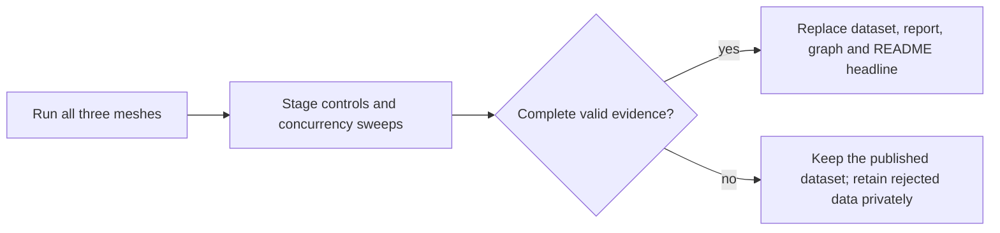

# Run the service-mesh comparison

Compare interlink, Linkerd, and Istio ambient using zero-delay HTTP echo.
View the [results](results/comparison.md) for latency, proxy resources, and throughput.



## Requirements

- A Linux host with Docker and room for a three-node kind cluster.
- Bash, Python 3, `curl`, `tar`, OpenSSL, Git, and network access.
- A clean, committed checkout.

The runner downloads tools and builds the workload and proxy images.

## Run manually

From the repository root:

```bash
./bench/run.sh
```

Each mesh runs a matched-load control before its capacity sweeps.
Defaults: 10,000 requests/s at 64 connections for the control; unlimited offered load for capacity.
Each point measures 20 seconds after a 10-second warm-up, with a five-second request timeout.
Requests and responses are 1 KiB for RPS and 1 MiB for bulk throughput.
Payload MiB/s measures each direction, not combined traffic.

| Variable | Default | Purpose |
| --- | --- | --- |
| `BENCH_DURATION` | `20` | Measured seconds per point. |
| `BENCH_RPS_CONCURRENCY` | `1,4,16,64,256,1024,4096` | RPS concurrency sweep. |
| `BENCH_BULK_CONCURRENCY` | `1,4,16,64,256,1024` | Bulk concurrency sweep. |
| `BENCH_SHARED_RPS` | `10000` | Common offered request rate. |
| `BENCH_SHARED_CONCURRENCY` | `64` | Common client count. |

To add controls to an existing capacity run on the same host and runtime:

```bash
./bench/run.sh --shared-only
```

Benchmarks run on your Linux host, never in CI.
CI only validates the checked-in results and graphs.

## Regenerate the graphs and report

```bash
python3 bench/scripts/aggregate.py --results bench/results --output bench/results/comparison.md --readme README.md
```

Append `--check` to check the report and graphs without changing files or running workloads.

Shared-host kind results do not establish production, connection-churn, or TLS-handshake capacity.
Use [production tuning](../docs/production-tuning.md) with your application traffic.
