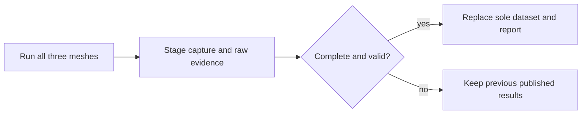

# Run the service-mesh comparison

Collect matched HTTP load profiles for interlink, Linkerd, and Istio ambient.
[`results/comparison.md`](results/comparison.md) is the only published performance
comparison; it records the capture date and measured source revision.



The report is published only after every mesh and declared profile passes
validation. Updating the harness or documentation does not refresh measurements.

## Prerequisites

- A Linux host with a running Docker daemon and capacity for a three-node kind cluster.
- Bash, Python 3, `curl`, `tar`, OpenSSL, and Git.
- A clean, committed checkout, or a source archive with its source commit SHA.
- Network access to download pinned tools and container images.

The runner installs its tools and builds the workload and interlink images.
You do not need a separate setup command or a host Rust toolchain.

For a source archive, set `BENCH_REVISION` to the full 40-character lowercase commit
SHA that produced it before running the command. The runner requires archived
source files to remain unchanged during capture.

## 1. Capture all three meshes

From the repository root, run:

```bash
./bench/run.sh
```

The runner collects all profiles in an ignored staging directory. Credentials,
kubeconfig, and execution logs stay outside published results.
After validation, it replaces `bench/results/` with the complete capture and report.
Setup, build, collection, validation, or source-revision failures leave the previous
published dataset unchanged.

Default workload:

- Target RPS and concurrent connections: `320:80`, `800:200`, and `1600:400`.
- Measured duration: 60 seconds per profile, after a discarded 10-second warm-up.
- Payload: 1,024 bytes.
- Application: [Go HTTP echo server](workloads/echo-server.go), with a 200 ms delay.

Set `BENCH_PROFILES` to comma-separated `qps:connections` pairs or
`BENCH_DURATION` to a positive number of seconds before invoking the same command.
Overrides apply to every mesh and are recorded in capture metadata.
Compare only reports with matching workload parameters.

Each mesh uses the same three-node kind topology, with the load generator and
application pinned to separate workers. Interlink uses explicit sidecars; Linkerd
uses injected sidecars; Istio ambient uses L4 ztunnel without an L7 waypoint.
These are different transport architectures, not identical deployments.

## 2. Verify the published capture

Open [`results/comparison.md`](results/comparison.md). Its single table reports
target and achieved RPS, p50 and p99 latency, proxy CPU in millicores, and proxy RSS
in MiB for each mesh/profile.

Check the following evidence in `bench/results/`:

| File | Purpose |
| --- | --- |
| `capture.json` | Actual capture times, source revision, run identifier, workload parameters, and tool versions |
| `<mesh>/fortio-<mesh>-q<QPS>-c<CONNS>.json` | Fortio load settings, response codes, achieved RPS, and latency |
| `<mesh>/metrics-<mesh>-q<QPS>-c<CONNS>.csv` | Proxy CPU and RSS samples during measurement |
| `<mesh>/metrics-<mesh>-q<QPS>-c<CONNS>.host.csv` | Host CPU samples during measurement |

The collector reads proxy CPU and RSS directly from kubelet `stats/summary`.
It does not require metrics-server.

Validation rejects incomplete cohorts, malformed or non-finite evidence, request
errors, achieved RPS below 97% of target, or host CPU utilization at or above 85%.
Declared load, payload, and duration must match the captured workload.
The measured source revision must remain unchanged before publication.

To validate and regenerate the report from an existing complete capture, run:

```bash
python3 bench/scripts/aggregate.py --results bench/results --output bench/results/comparison.md
```

Successful reporting writes the comparison. Failed validation does not overwrite
an existing valid report. Regenerating Markdown does not recapture the workload.

## Automatic refresh

The [owned benchmark workflow](../.github/workflows/benchmarks.yml) runs on relevant
`main` source/harness changes, weekly, and by manual dispatch. It publishes only
a complete valid capture and refuses to push if the measured source has advanced.
All steps run repository-controlled commands; no third-party Actions are used.

Preflight checks that the table matches its recorded evidence. A failed capture
keeps the previous capture and its original timestamp; it never makes old data
look fresh.

## Questions

### Does this measure maximum capacity?

No. The fixed-delay workload measures the declared HTTP profiles. It does not
establish saturation throughput, connection-churn cost, or large-payload performance.
Kind workers share a host; they do not reproduce independent physical machines.

### Do the results describe the latest source?

Only if the recorded capture revision matches that source. Read `capture.json`
and the report's date and revision; do not infer freshness from a documentation change.

### Can a partial run update the comparison?

No. Publication requires evidence for every mesh and declared profile from one
complete capture. Fix the failure and rerun the complete command.

## Next steps

Use [production tuning](../docs/production-tuning.md) to evaluate operational settings
with your own traffic. Internal semantic-path checks remain correctness gates;
they are not additional published performance comparisons.

