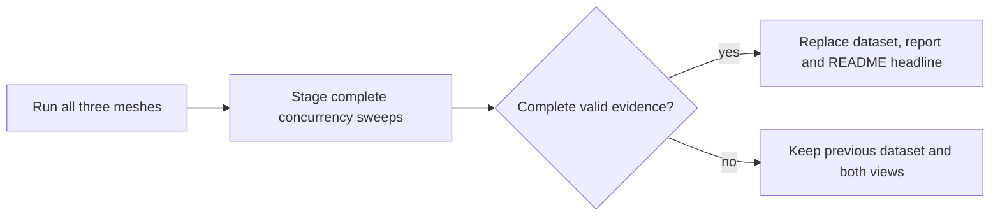

# Run the service-mesh echo capacity comparison

Compare interlink, Linkerd, and Istio ambient on one Linux machine.
[`results/comparison.md`](results/comparison.md) is the canonical comparison;
the root [README headline](../README.md#benchmarks) is a generated view of the
same selected points and capture, never a separately maintained benchmark.



## Prerequisites

- A Linux host with Docker and capacity for a three-node kind cluster.
- Bash, Python 3, `curl`, `tar`, OpenSSL, and Git.
- A clean, committed checkout, or a source archive with its source commit SHA.
- Network access to download pinned tools and container images.

The runner installs tools and builds the workload and Interlink images.
For an archive, set `BENCH_REVISION` to its full lowercase 40-character source
commit SHA. Source files must remain unchanged throughout the capture.

## 1. Capture all three meshes

From the repository root:

```bash
./bench/run.sh
```

The predeclared experiment uses unlimited Fortio offered load (`-qps 0`) against
the [Go HTTP echo server](workloads/echo-server.go), with **zero application delay**:

| Workload | Request and identical response | Concurrent connections |
| --- | --- | --- |
| RPS | 1 KiB each | 1, 4, 16, 64, 256, 1024, 4096 |
| Bulk | 1 MiB each | 1, 4, 16, 64, 256, 1024 |

The 1 KiB sweep uses Fortio's fast client. Bulk uses `-stdclient` with a
full-duplex writer/reader; that client choice is identical across all meshes.
Raw `DisableFastClient` must be false for RPS and true for bulk.

Every point runs for 20 measured seconds after a separate 10-second warm-up.
In-flight requests may extend actual elapsed duration; rates use that actual duration.
Every mesh uses the same five-second request timeout. Timeouts remain counted
request errors, not successful throughput; malformed results still abort the capture.
Set `BENCH_RPS_CONCURRENCY` or `BENCH_BULK_CONCURRENCY` to comma-separated distinct
positive concurrency values, or `BENCH_DURATION` to positive measured seconds.
Declare overrides before the run; they apply to every mesh and are recorded.
Every point is attempted and retained, not overwritten by a winning rerun.

Each mesh uses the same three-node kind topology with load generator and application
on separate workers sharing one Linux host. Interlink uses explicit sidecars;
Linkerd uses injected sidecars; Istio ambient uses L4 ztunnel without an L7 waypoint.
These are different transport architectures, not identical deployments.

The runner stages raw evidence and the README in an ignored directory. Credentials,
kubeconfig, and diagnostic logs remain private. Only after complete validation and
source guards succeed does it replace `bench/results/` and the generated README region.
Generated README changes cannot trip or bypass the source guards.
Collection, validation, source-change, or publication failures preserve the previous
dataset and headline. Existing fixed-rate/200 ms results are not capacity results
and are never converted or relabeled; only a fresh full capture can replace them.

On failure, collected raw evidence is retained privately under
`tmp/rejected-capture-<run-id>`; credentials and diagnostic files are deleted.

## 2. Verify the published capture

The canonical report has one three-row table: peak measured 1 KiB RPS, p99 at that
RPS peak, peak measured 1 MiB payload MiB/s each direction, and proxy CPU/RSS at
the RPS peak. The README shows the same RPS, throughput, and p99 values.
The two peaks may occur at different concurrency values.

| Evidence in `bench/results/` | Purpose |
| --- | --- |
| `capture.json` | Schema 2, `echo-capacity`, actual times/runtime revision/host/versions, input SHA256 map, workload grids and selected `peaks` concurrency |
| `<mesh>/fortio-<mesh>-<workload>-c<N>.json` | Actual rates/duration, measured and warm-up response codes, latency and response sizes |
| `<mesh>/metrics-<mesh>-<workload>-c<N>.csv` | Timestamped proxy CPU and RSS during measurement |
| `<mesh>/metrics-<mesh>-<workload>-c<N>.host.csv` | Host CPU samples during measurement |

`revision` identifies runtime Rust source. `harness_sha256` separately records
relative-path SHA256 hashes of the actual benchmark scripts, workload sources and
manifests, benchmark entrypoints, root Dockerfile and Cargo manifest/lock.
This pins the measured experiment even when its harness is committed after the
runtime revision. Hashes are captured from real input bytes before measurement;
they are provenance, not a requirement that later documentation or generated views
match the measured checkout.

Normalized Fortio records retain all statistics, replacing only the large encoded
request `Payload` with its actual `PayloadBytes` and `PayloadSHA256`; actual warm-up
response counts are retained as `WarmupRetCodes`.
The echo server sends an explicit `Content-Length`. For fast-client RPS,
`Sizes.Sum - HeaderSizes.Sum` is actual echoed payload bytes. For standard-client
bulk, `Sizes.Sum` records the response body alone; the actual `HeaderSizes` histogram
must have zero or exactly the request count with all-zero byte statistics.
This is Fortio's documented client accounting, not a missing-data substitute;
absent or inconsistent fields fail. Standard-client failed reads may record
`Sizes` values of -1; those retained error boundaries cannot win either peak.
At an error-free point, actual echoed bytes must equal request count times request
payload length. Divide those bytes by actual elapsed seconds and $2^{20}$ for
**MiB/s each direction**, never request-plus-response or TLS/header throughput.

Fortio 1.66 labels partial standard-client reads `204` and considers 2xx/418
successful for its error histogram ([source](https://github.com/fortio/fortio/blob/v1.66.0/fhttp/http_client.go)).
The reporter checks that histogram using Fortio's classification but requires
`200` and complete echoed bytes for headline eligibility. Partial reads cannot win.

CPU comes from UID/node-scoped kubelet `stats/summary`. RSS comes from timestamped
`/metrics/cadvisor` `container_memory_rss`, matched to the exact API container ID
and pod-UID cgroup on the required node. Missing, duplicate, stale, or invalid RSS
fails the capture; working set and zero are never substitutes. Metrics-server is
not required.

Only points with zero warm-up and measured request errors can win a peak.
Request-error points remain visible saturation/error boundaries in the report and raw
capture. A complete capture needs an eligible point for each mesh and workload.
Missing/malformed/non-finite/stale evidence, incomplete grids, moved or restarted
proxy containers, and source changes fail publication, never become capacity zeros.
Capacity testing intentionally saturates the host: host CPU samples remain evidence,
but the former fixed-target 97% achievement and 85% host-CPU gates do not apply.

To regenerate both views from a complete capacity capture:

```bash
python3 bench/scripts/aggregate.py --results bench/results --output bench/results/comparison.md --readme README.md
```

Append `--check` to verify both without modifying either. Regeneration does not
recapture or re-date measurements. The reporter verifies `capture.json` peak
concurrency against every raw point; ties retain the first predeclared point.
`--readme` defaults to the repository root README, also for `make -C bench report`.
Exactly one ordered, standalone marker pair is required:
`<!-- BEGIN GENERATED MESH HEADLINE -->` / `<!-- END GENERATED MESH HEADLINE -->`.
Absent, duplicate, reversed or malformed markers reject both views. Content outside
the generated region is preserved.

## Manual refresh

The [owned workflow](../.github/workflows/benchmarks.yml) runs only by manual
dispatch in GitHub Actions—never on pushes or a schedule. Run it deliberately for
releases or performance changes. Normal CI validates the recorded dataset and both
generated views without starting a capacity sweep.

A manual run commits the dataset, canonical report and README together, refusing
stale-source publication. Pushes are ordinary fast-forwards, never force pushes or
rebases of stale evidence. No third-party Actions run. Failure retains the previous
dataset, headline and original timestamps.

## Limits

These are **peak measured results within the stated concurrency sweep on this Linux
machine**, not intrinsic or theoretical maximum capacities. If the largest tested
concurrency still wins, the report labels that tested-range limit; it does not prove
the machine's absolute ceiling. Shared-host kind workers do not reproduce separate
physical machines or production networks. The sweeps do not establish connection-churn
or TLS-handshake capacity. CPU/RSS are not live per-connection allocation measurements.

Read the source revision and capture date before applying results. A harness or
documentation update does not establish performance for a new source revision.
Use [production tuning](../docs/production-tuning.md) for deployment-specific traffic.
Internal semantic-path checks remain correctness gates, not additional public comparisons.

