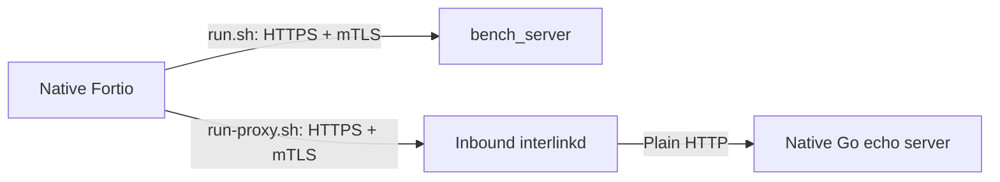

# Run local interlink HTTP benchmarks

Use these native Fortio scripts to measure a direct mTLS server or one inbound
proxy without Kubernetes. For the native Veyrmux cutover, read the
[latest two-proxy comparison](../../docs/benchmarks/results.md) and
[raw comparison data](../results/veyrmux-integration/comparison.json).



Neither path includes an outbound proxy or proxy-to-proxy mux. A full
two-proxy Fortio workload runs through the [kind harness](../README.md#full-comparison-kubernetes);
Criterion's complete TCP lifecycle cases use a separate workload.

## Prerequisites

- Rust 1.89 or later and Cargo in `PATH`.
- Go in `PATH` to install native Fortio `1.66.0` and build the Go echo server.
- Python 3 and standard shell tools, including `ps` and `awk`.
- `curl` and `nc` for `run-proxy.sh`.
- Available default ports: `18443` for `run.sh`; `14443`, `18080`, and the
  proxy's metrics port `4190` for `run-proxy.sh`.

Docker is not required. Keep build artifacts on disk, not a RAM-backed
temporary filesystem.

> **Warning:** These scripts regenerate shared demo certificates.
> `run-proxy.sh` enables `INTERLINK_ALLOW_ALL=true` for its test proxy.
> Run them only in an isolated benchmark environment, one at a time.

## Run

Run commands from the repository root unless stated otherwise.

1. Choose a direct TLS-server or single-proxy profile:

   ```bash
   # Direct TLS server: three profiles, 60 measured seconds each.
   BENCH_DURATION=60 ./bench/local/run.sh
   ```

   ```bash
   # One inbound proxy: zero-delay churn and bulk profiles, 60 seconds each.
   CARGO_TARGET_DIR=target/bench cargo build --release --bin interlinkd
   PROFILE_DELAY=0 QUICK=1 CHURN=1 BULK=1 SKIP_STANDARD=1 ./bench/local/run-proxy.sh
   ```

   `run.sh` rebuilds its server. `run-proxy.sh` builds `interlinkd` only if the
   selected binary is missing; rebuild it explicitly after changing source.

2. Inspect the generated summaries and profile JSON under
   [`bench/local/results/`](results/). Check achieved RPS, latency, errors,
   payload, duration, and capture conditions before comparing runs.

3. Preserve the run conditions alongside any numbers you publish. A new
   local Fortio run is not the published native-Veyrmux A/B.

The direct server always adds **200 ms** per request. The proxy script defaults
to 200 ms but accepts `PROFILE_DELAY=0`; its generated header records the selected
delay. Both scripts use a discarded 30-second warm-up per profile.

## Profiles

| Script / profile | Target RPS | Connections | Request payload | Connection reuse |
| --- | ---: | ---: | ---: | --- |
| Either script / standard light | 320 | 160 | 1,024 B | Fortio default keepalive |
| Either script / standard medium | 3,200 | 1,600 | 1,024 B | Fortio default keepalive |
| Either script / standard heavy | 12,800 | 6,400 | 1,024 B | Fortio default keepalive |
| Proxy / churn light | 100 | 1 | 1,024 B | Disabled |
| Proxy / churn heavy | 500 | 5 | 1,024 B | Disabled |
| Proxy / bulk 64 KiB | 100 | 2 | 65,536 B | Fortio default keepalive |
| Proxy / bulk 256 KiB | 50 | 2 | 262,144 B | Fortio default keepalive |

Measured duration defaults to 300 seconds per profile. For `run-proxy.sh`,
`QUICK=1` selects 60 seconds; `BENCH_DURATION` overrides either mode.
The kind harness's 60-second cap does not apply here.

The direct-server native `c1600` and `c6400` profiles encountered listener-backlog
failures in November 2026; they are not verified replacements for the July
containerized captures. See the [recorded limitation](../../docs/performance-plan.md#r31--pooled-un-zeroed-relay-buffers-the-18th-round-root-cause-fixed).

## Options

These are script inputs, not a complete list of proxy runtime settings.

| Name | Type | Required | Default | Description |
| --- | --- | --- | --- | --- |
| `BENCH_DURATION` | Integer seconds | No | `300` | Set measured seconds per profile in either script; overrides `QUICK`. |
| `QUICK` | `0` or `1` | No | `0` | Select 60-second proxy profiles when `1`; does not affect `run.sh`. |
| `PROFILE_DELAY` | Go duration | No | `200ms` | Set the proxy script's echo-server delay; use `0` for no delay. |
| `CHURN` | `0` or `1` | No | `0` | Add both no-keepalive proxy profiles when `1`. |
| `BULK` | `0` or `1` | No | `0` | Add both large-payload proxy profiles when `1`. |
| `SKIP_STANDARD` | `0` or `1` | No | `0` | Skip the proxy script's three standard profiles when `1`. |
| `CARGO_TARGET` | Path | No | Repository `target/bench` | Select the proxy script's build target directory. |
| `INTERLINK_BIN` | Executable path | No | `$CARGO_TARGET/release/interlinkd` | Select the proxy binary; an existing binary is not rebuilt. |
| `INBOUND_PORT` | Port number | No | `14443` | Select the proxy script's inbound listener port. |
| `ECHO_PORT` | Port number | No | `18080` | Select the proxy script's HTTP echo listener port. |
| `METRICS_URL` | HTTP base URL | No | `http://127.0.0.1:4190` | Select the handshake scrape endpoint; does not change the proxy's metrics listener. |

`BENCH_PROFILES` is a kind-harness option; neither local script reads it.

## Output

All paths below are relative to `bench/local/`.

| Path | Contents |
| --- | --- |
| `results/fortio-interlink-q<RPS>-c<connections>.json` | Direct TLS-server Fortio result. |
| `results/metrics-interlink-q<RPS>-c<connections>.csv` | Direct TLS-server process CPU and RSS samples. |
| `results/summary.md` | Direct TLS-server summary, replaced each run. |
| `results/fortio-proxy-interlink-<profile>.json` | Single-proxy Fortio result. |
| `results/fortio-proxy-interlink-<profile>.log` | Single-proxy Fortio command log. |
| `results/metrics-proxy-interlink-<profile>.csv` | Proxy process CPU and RSS samples. |
| `results/section-proxy-interlink-<profile>.md` | Per-profile summary and capture timestamp/revision. |
| `results/section-00-header.md` | Header describing the most recent proxy invocation. |
| `results/section-zz-handshake.md` | Final handshake counters, when the metrics scrape succeeds. |
| `results/proxy-summary.md` | Concatenation of all saved proxy section files. |

Proxy profile suffixes are `q320-c160`, `q3200-c1600`, `q12800-c6400`,
`churn-q100-c1`, `churn-q500-c5`, `bulk-64kb`, and `bulk-256kb`.
Targeted runs replace only their own profile sections. A summary can therefore
contain multiple capture dates; its newest header does not describe every section.

CPU/RSS sampling starts before the warm-up and runs for the configured duration,
so its window is not aligned with the complete measured Fortio run.

## Run the current two-proxy lifecycle cases

From the repository root:

```bash
cargo bench --bench data_plane -- 'proxy_relay/(mux|legacy)_(small|16kb)$'
```

This measures the checked-out runtime, not the published matched runtime A/B.
That comparison requires identical harness sources across both runtime revisions
and a fresh loopback-only Linux network namespace per block.
Follow the [reproduction requirements](../README.md#run-the-current-runtime-lifecycle-cases);
do not substitute a single local Fortio invocation.

## Q&A

**Does `run-proxy.sh` exercise native Veyrmux?** No. It has no outbound proxy
or proxy-to-proxy tunnel.

**Are the saved local results current native-cutover measurements?** No.
The [July direct-server capture](../results/local.md) and November 16 proxy
profiles are historical and use different workloads from the latest comparison.

**Can I compare July and November local latencies directly?** No. The local
scripts now run Fortio and their servers natively; July used containerized legs.
Compare matching topology and workload conditions instead.

Next, read the [native-mux results](../../docs/benchmarks/results.md) or choose
another workload in the [benchmark guide](../README.md).
