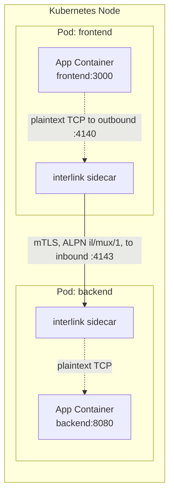
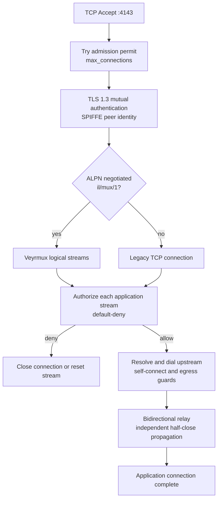
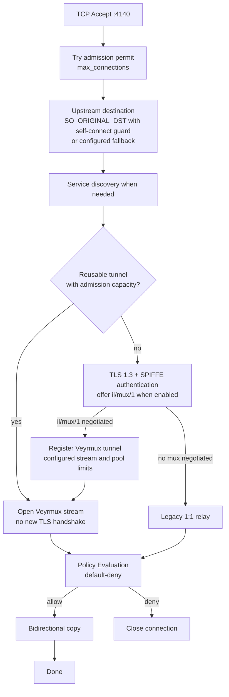

# Architecture Overview

The proxy-to-proxy transport uses native Tokio
[Veyrmux](https://github.com/alexandernicholson/veyrmux), with Yamux-v0 wire
compatibility under ALPN `il/mux/1`. Existing stock-Yamux peers remain compatible;
peers without mux negotiation use one-to-one relays.

## Deployment Topology

## Connection Lifecycle (Inbound)

## Connection Lifecycle (Outbound)

One logical stream carries one application TCP connection. Reusing a tunnel does
not reuse a finished application stream. Authorization and stream admission
remain per connection; half-close on one direction does not discard reverse
traffic.

`INTERLINK_MUX=false` removes the mux offer, not support for speaking a negotiated
protocol. Stock Yamux and the Tokio/Futures adapter are test-only dependencies;
production relay I/O stays native Tokio.

